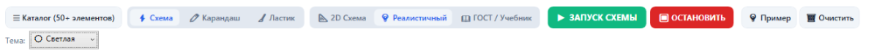
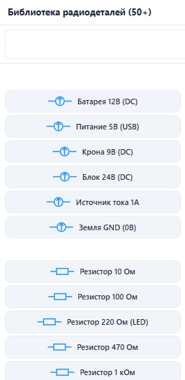
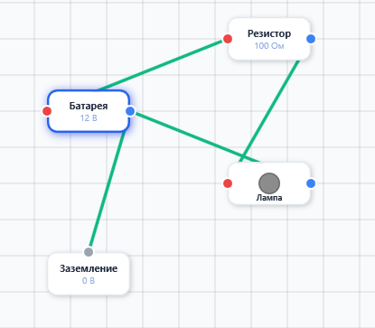

# ⚡ ElectroStudio Pro (ЭлектроСтудия)

  <b>Современная интерактивная среда моделирования электрических цепей, симуляции токов (MNA), проверки законов физики и решения уравнений.</b>

---

## 📸 Скриншоты интерфейса

### 🛠 Панель инструментов и режимы

---

### 📚 Множество элементов (50+ радиодеталей)
Встроенная библиотека содержит источники питания, пассивные элементы, полупроводники, измерительные приборы и логические вентили с удобным поиском и визуальными миниатюрами.

  

---

### 💡 Моделирование цепи и интерактивные компоненты
- **Интерактивный ключ/выключатель**: переключается по клику мыши (вкл/выкл) с мгновенным перерасчётом всех токов и напряжений.
- **Интуитивное соединение**: создание цепей перетаскиванием проводов между контактами.

  

---

### 📖 Инспектор свойств и встроенная энциклопедия деталей
При выборе любого элемента отображаются его параметры, возможность поворота на 90° и подробная физическая справка: как компонент работает и зачем он нужен в схеме.

  

---

## ✨ Основные возможности
1. **Режимы отображения**:
   - 💡 **Реалистичный стиль** (светящиеся лампы, цветные карточки элементов).
   - 📖 **ГОСТ / Учебник физики** (классические академические обозначения по ГОСТ).
   - 📐 **2D Схема**.
2. **Математический движок MNA**:
   - Точный расчёт токов, потенциалов узлов и выделяемой мощности.
3. **Решение формул и рукописного текста**:
   - Ввод и расчёт выражений вида `I1 + I2 =`, `U(R1) * 2 =` как через панель, так и прямо рукописным карандашом на холсте.
4. **Светлая и тёмная темы**:
   - По умолчанию открывается в комфортной светлой теме, доступно мгновенное переключение на тёмную.
5. **Навигация**:
   - Зум холста через `Ctrl + колёсико мыши`.
   - Разделяемые сплиттерами панели состояния и таблицы параметров.

---

## 🚀 Быстрый запуск
1. Перейдите в раздел **[Releases](https://github.com/m1ssl3/ElectroStudio/releases)**.
2. Скачайте архив **`ElectroStudio-v1.0.0-win-x64.zip`**.
3. Распакуйте и запустите **`ElectroStudio.exe`**.
