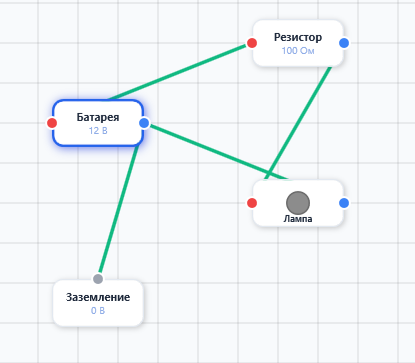

# ElectroStudio

Десктопная программа для моделирования и расчёта электрических цепей постоянного тока (DC) с поддержкой ГОСТ-обозначений и встроенным симулятором.

Проект написан на C# (WPF, .NET 10).

---

## Возможности

### 1. Схемотехника и режимы отображения
- **Режим ГОСТ (ЕСКД)**: отрисовка элементов по академическим стандартам (прямоугольники резисторов с вынесенным обозначением, источники ЭДС со стрелками, лампы с диагональным крестом).
- **Схемотехнический и цветной вид**: переключение между ГОСТ-схемой и цветными карточками компонентов.
- **Поворот элементов**: вращение на 90°, 180° и 270° с корректным пересчётом положений контактов (пинов) и хитбоксов.
- **Интерактивные элементы**: ключи и выключатели переключаются по клику мыши с пересчётом параметров цепи на лету.

### 2. Расчёт цепей (MNA Solver)
- В основе лежит метод узловых потенциалов (Modified Nodal Analysis).
- Расчёт токов в ветвях, узловых напряжений и мощности ($P = U \cdot I$).
- Поддержка источников постоянного напряжения и тока, резисторов, диодов, ламп и измерительных приборов (вольтметры, амперметры).

### 3. Инструменты и холст
- Рисование поверх схемы от руки для пометок и заметок к задачам.
- Анализ формул законов Ома и Кирхгофа прямо по нарисованной схеме.
- Масштабирование холста (Ctrl + колёсико мыши) и панорамирование.
- Сохранение и загрузка проектов в формате `.elec` (JSON).

---

## Скриншоты

| Схема цепи и моделирование | Библиотека компонентов |
|---|---|
|  |  |

| Панель управления и режимы | Инспектор параметров |
|---|---|
|  |  |

---

## Установка и запуск

### Готовая сборка
1. Скачать архив из раздела [Releases](https://github.com/m1ssl3/ElectroStudio/releases).
2. Распаковать архив и запустить `ElectroStudio.exe`.

### Сборка из исходного кода
Для сборки требуется .NET 10 SDK:

```bash
git clone https://github.com/m1ssl3/ElectroStudio.git
cd ElectroStudio
dotnet build -c Release
```

---

## Управление
- **ЛКМ** — выбор инструмента, выделение и перетаскивание компонентов, переключение выключателей.
- **Тянуть за контакт (Pin)** — протянуть соединительный провод.
- **R** или кнопка на панели — повернуть выбранный элемент на 90°.
- **Delete** — удалить выделенный элемент или провод.
- **Ctrl + Колёсико мыши** — зум холста.
