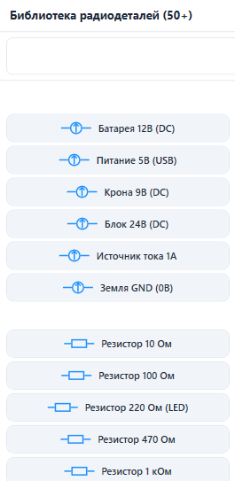
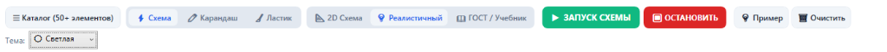

# ⚡ ElectroStudio (ЭлектроСтудия)

<p align="center">
  
  <br/>
  <b>Современная интерактивная CAD-среда для моделирования электрических цепей, симуляции токов (MNA), интерактивного рисования схем и решения физических уравнений.</b>
</p>

<p align="center">
  <a href="https://github.com/m1ssl3/ElectroStudio/releases"></a>
  
  
  
</p>

---

## 🌟 Ключевые возможности

### 🎨 1. Три режима отображения компонентов
- 💡 **Реалистичный стиль**: яркие цветные компоненты, светящиеся лампы (Glow Effect), реалистичные вольтметры и амперметры.
- 📖 **ГОСТ / Учебник физики**: строгие академические обозначения по стандартам ЕСКД / ГОСТ (вынесенные за пределы контура номиналы $R$, обозначения $E$, $L$, $C$, крестовые лампы).
- 📐 **2D Схема**: минималистичный схемотехнический вид для быстрого прототипирования.

### 📐 2. Физический движок расчёта цепей (MNA Solver)
- Метод узловых потенциалов (Modified Nodal Analysis).
- Честный расчёт токов в каждой ветви, падений напряжений на элементах и рассеиваемой мощности ($P = U \cdot I$).
- Интерактивные выключатели/ключи: переключение в 1 клик с мгновенным автоматическим пересчётом всей схемы в реальном времени.

### ✍️ 3. Интеллектуальная рисовалка и решение формул
- Рисование от руки поверх схемы карандашом с распознаванием знаков ($+$, $-$, $=$) и привязкой к реальным переменным схемы ($I_1$, $U_1$, $R_1$).
- Автоматический расчёт законов Ома и правил Кирхгофа прямо на холсте.

### 🔄 4. Умный поворот и трассировка
- Вращение компонентов на $90^\circ$, $180^\circ$, $270^\circ$ с точным пересчётом координат контактов (Pins) и сохранением целостности соединительных проводов.
- Автоматическое выравнивание и интуитивная трассировка соединений перетаскиванием между контактами.

### 🚀 5. Встроенная система OTA-обновлений (One-Click Update)
- Фоновая проверка свежих версий через GitHub Releases API.
- Бесшовное скачивание и автообновление через фоновый процесс без блокировки исполняемых файлов.

---

## 📸 Скриншоты интерфейса

<div align="center">
  <table>
    <tr>
      <td align="center"><b>💡 Моделирование схемы и светящиеся лампы</b></td>
      <td align="center"><b>📚 Библиотека компонентов (50+ радиодеталей)</b></td>
    </tr>
    <tr>
      <td></td>
      <td></td>
    </tr>
    <tr>
      <td align="center"><b>🛠 Панель инструментов и режимы рисования</b></td>
      <td align="center"><b>📖 Инспектор свойств и физическая справка</b></td>
    </tr>
    <tr>
      <td></td>
      <td></td>
    </tr>
  </table>
</div>

---

## ⚡ Быстрый старт

### Скачать готовую версию
1. Перейдите в раздел **[Releases](https://github.com/m1ssl3/ElectroStudio/releases)**.
2. Скачайте свежий архив **`ElectroStudio-vX.X.X-win-x64.zip`**.
3. Распакуйте в любую папку и запустите **`ElectroStudio.exe`**.

### Сборка из исходников
Требуется [.NET 10.0 SDK](https://dotnet.microsoft.com/download) или выше:
```bash
# Клонировать репозиторий
git clone https://github.com/m1ssl3/ElectroStudio.git
cd ElectroStudio

# Собрать и запустить
dotnet build -c Release
dotnet run --project CircuitCanvas.csproj
```

---

## 📄 Лицензия
Распространяется под лицензией [MIT](LICENSE).
Создано для удобного изучения электротехники, физики и быстрого моделирования схем.
